

# 💗 Heart Crossing · 愛心過馬路

**Hop a little heart across busy roads — then build your own cute town!**
A free, cozy browser game for kids (and grown-ups). No install, no ads, no sign-up.

### [▶ Play now](https://designowpro-debug.github.io/heart-crossing-game/) · [🏡 Free Build](https://designowpro-debug.github.io/heart-crossing-game/?mode=free)

[English](https://designowpro-debug.github.io/heart-crossing-game/?lang=en) · [中文](https://designowpro-debug.github.io/heart-crossing-game/?lang=zh)

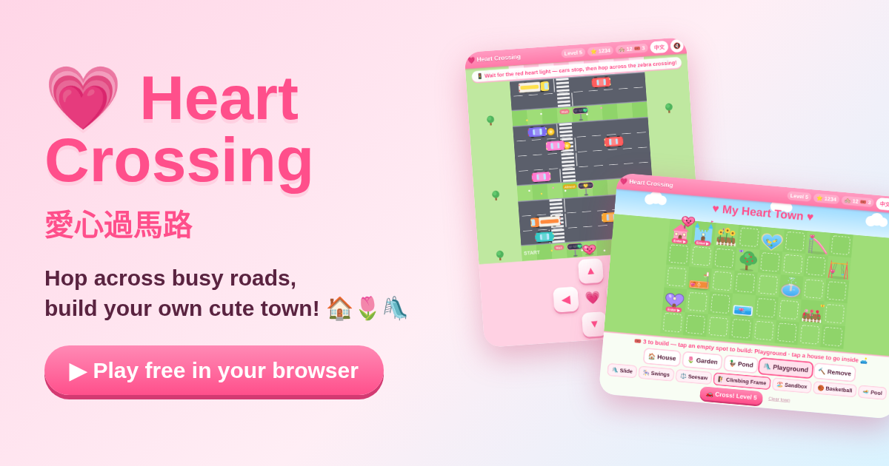

## ✨ Features

- 🚗 **Road crossing** — dodge colorful cars and trucks in lanes that get busier every level
- 🚦 **Heart-shaped traffic lights** — on red, cars brake and queue up so you can hop over the zebra crossing
- 🏠 **Build a town** — every successful crossing earns a build: houses (4 styles, 6 colors), gardens, ponds and playgrounds
- 🛋️ **Go inside your houses** — decorate each room with 12 kinds of furniture: drag, flip and remove
- 🌷 **Living town** — swaying flowers, butterflies, ducks and fish, a fountain, swings, a slide, a seesaw, a sandbox, a basketball court and a pool. Tap them for fun animations!
- 🏡 **Free Build mode** — no cars, no levels, no tickets: just build as much as you like on a bigger 10×6 map. Direct link: [`?mode=free`](https://designowpro-debug.github.io/heart-crossing-game/?mode=free). Your free town is saved separately, so it never touches your challenge town
- 👗 **Dress Up (paper doll)** — start from an empty silhouette and build a cute girl part by part: face & skin tone, eyes, brows, mouth, makeup, 9 hairstyles + hair colors, tops, bottoms, dresses, shoes and accessories (bows, tiaras, hats, glasses, earrings, necklaces, bags, wings). 🎲 Random, ↩ Undo, 3 outfit slots. She then walks around your town (tap where to go) and into your houses
- 🦎 **Pet axolotl** — adopt a fluffy axolotl, name it and pick a color (white, pink, gold, blue, black). Feed 🍤, bathe 🫧, play 🎾 and pet 💖 it. It follows the girl everywhere, swims in ponds, and you can build an **Axolotl Tank** inside your houses
- 📸 **Share your town** — one tap makes a cute picture of your town (or "I cleared Level N!") to share or save, no accounts or tracking
- 🌐 **English & 中文** — switch any time with the language button
- 📱 **iPad & phone friendly** — big touch buttons, swipe controls, works in portrait and landscape, add to Home Screen for fullscreen
- 💾 **Saves automatically** in your browser — works offline once loaded, it's a single HTML file

## 🎮 How to play

1. Tap **Play**. Move with the big arrow buttons, by swiping, or with the arrow keys / WASD (tap the screen = hop forward).
2. Watch the heart traffic lights: **red heart = cars stop** → cross at the zebra crossing!
3. If a car bonks you, just try again. Your town is always kept.
4. Reach the **FINISH** row to earn a build 🎟️, then tap an empty spot in your town to build.
5. Tap a house to go inside and decorate. Tap gardens, ponds and playground items to see what happens!

**Dress up & pets:** tap **👗 Dress Up** or **My Axolotl** on the title screen or in your town. In town, tap anywhere to walk the girl there; tap a house and she walks inside. Tap the axolotl to say hi!

**Just want to build?** Tap **🏡 Free Build** on the title screen (or open [https://designowpro-debug.github.io/heart-crossing-game/?mode=free](https://designowpro-debug.github.io/heart-crossing-game/?mode=free)). Tap **🏠 Menu** to go back.

## 📸 Screenshots

| Title | Crossing (portrait) | Town |
|---|---|---|
| 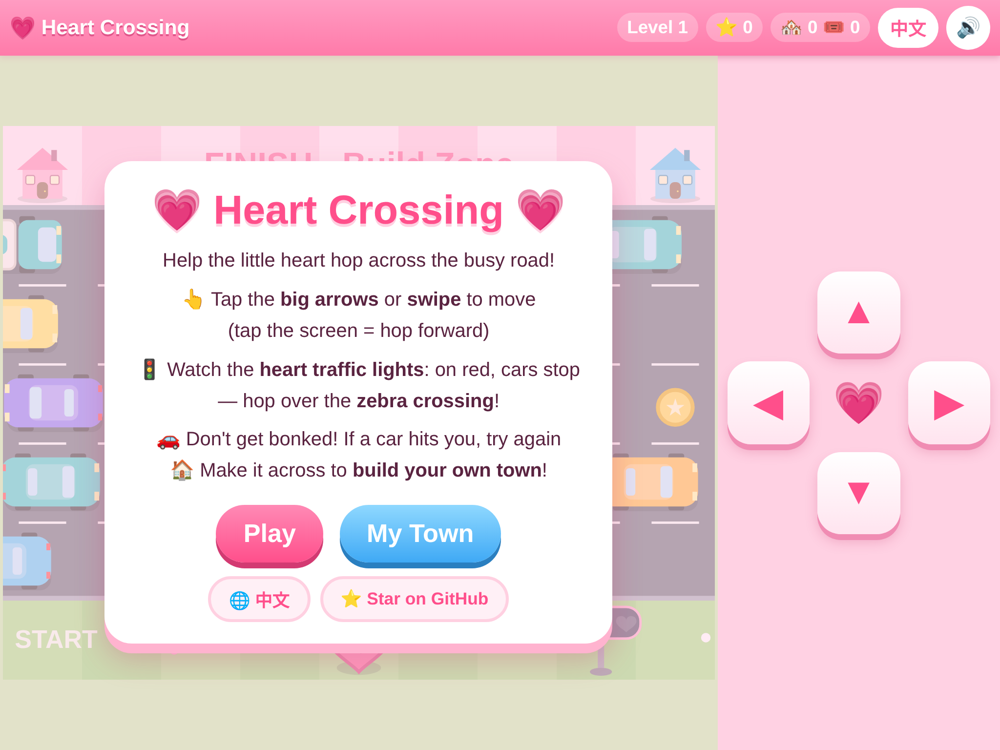 | 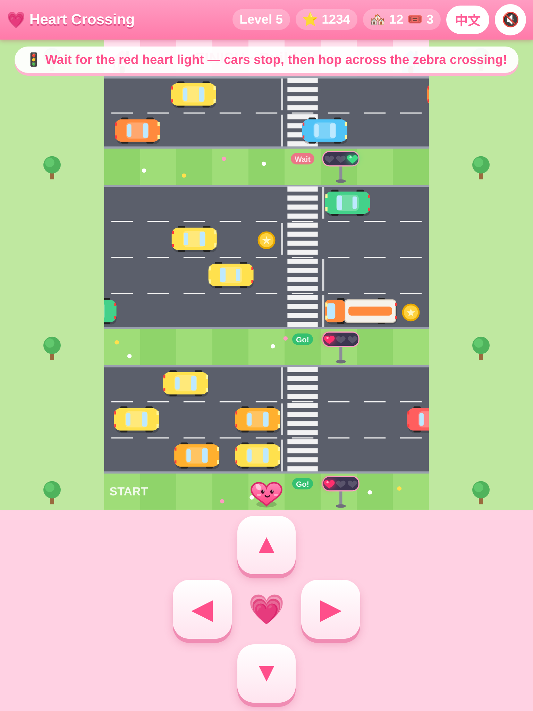 | 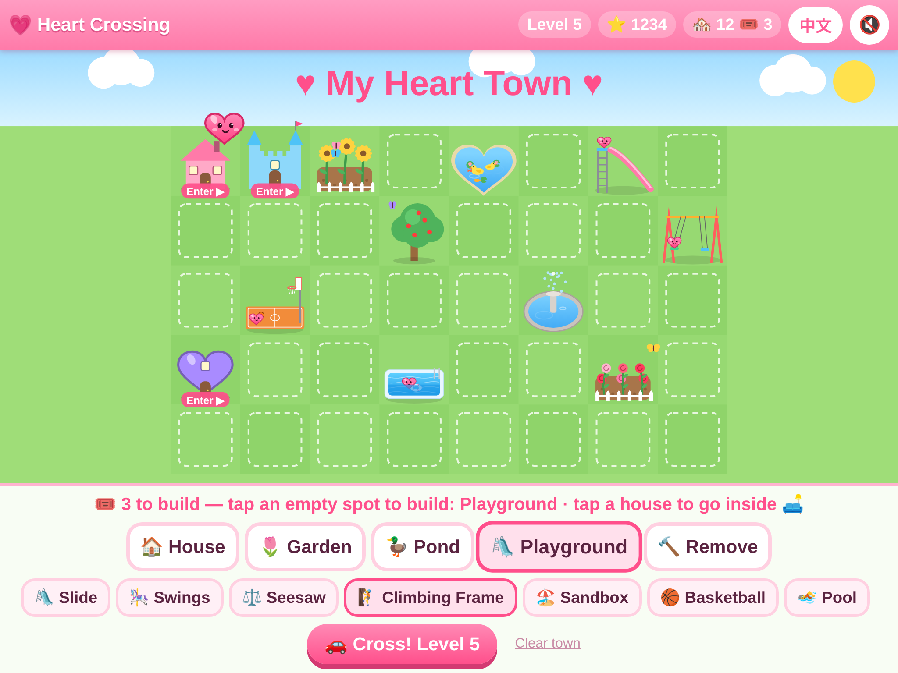 |

| Free Build | Inside a house | Heart traffic lights |
|---|---|---|
| 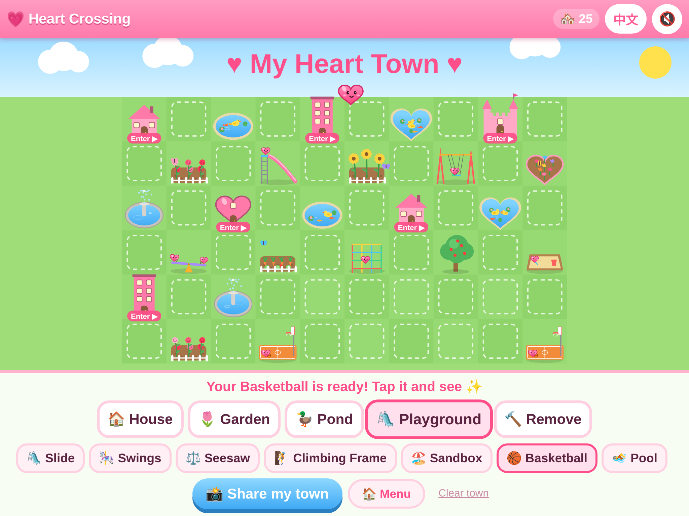 | 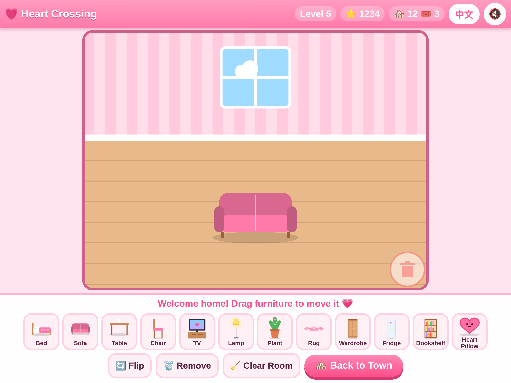 | 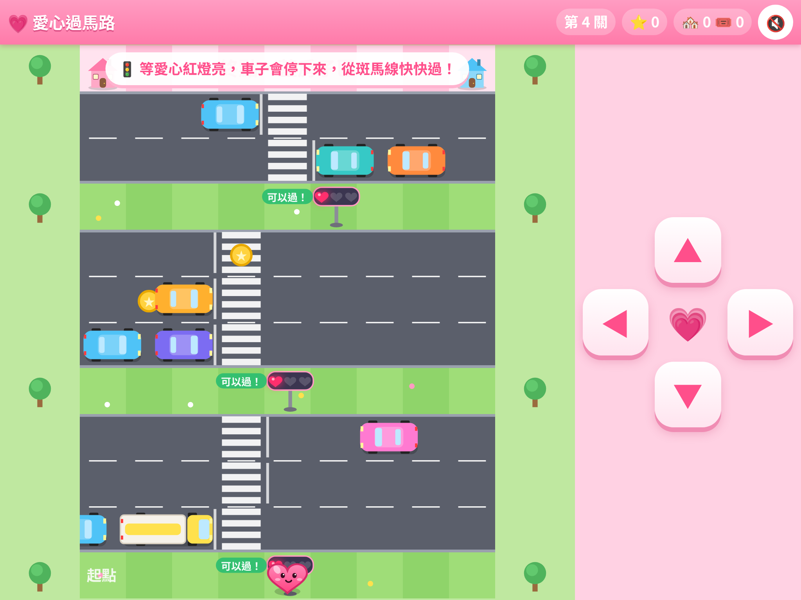 |

| Dress Up | Girl in town | Pet axolotl |
|---|---|---|
| 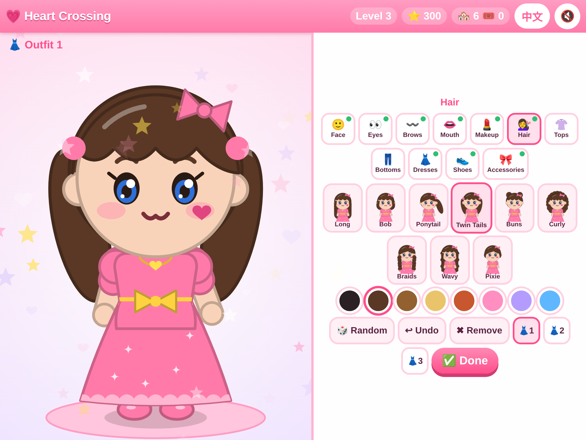 | 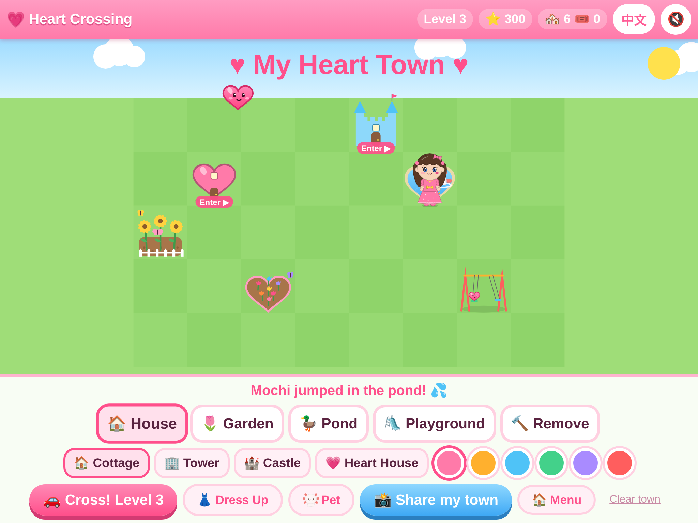 | 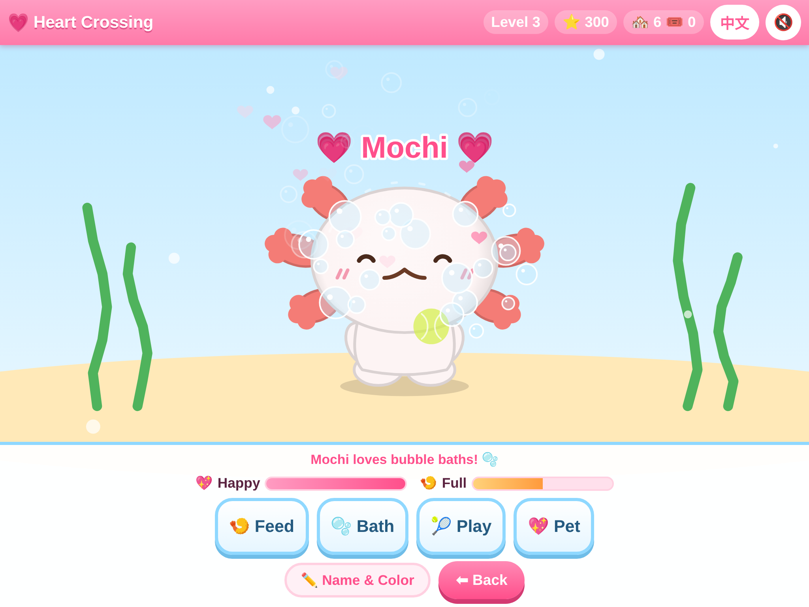 |

| 中文版 Playground | 中文版 打扮 |
|---|---|
| 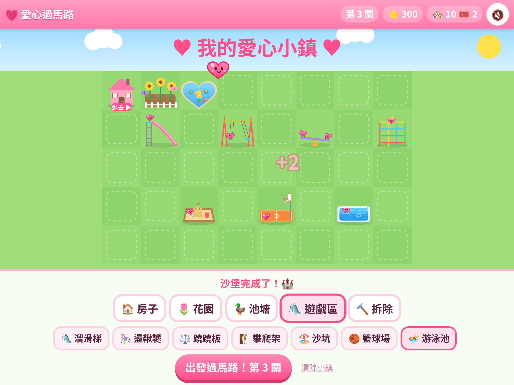 | 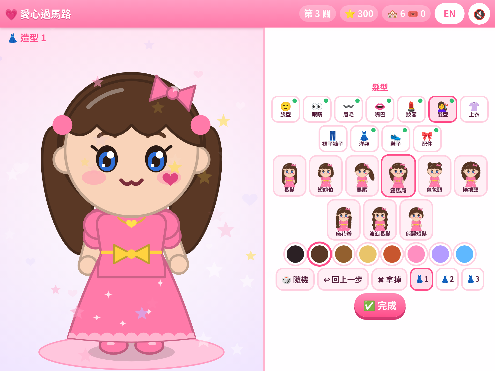 |

<b>Share image</b> 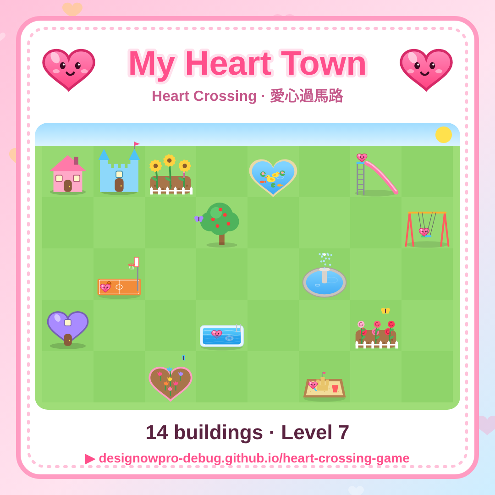

## 🛠️ Tech

One self-contained `index.html`: HTML5 canvas, vanilla JavaScript and the Web Audio API. No frameworks, no build step, no external requests. To run it locally, just download `index.html` and open it.

## 📄 License

[MIT](LICENSE) © 2026 designowpro-debug. Have fun, remix it, share it! If you enjoy the game, please ⭐ star the repo.

---

## 🇹🇼 中文介紹

**愛心過馬路** 是一款可愛的免費網頁小遊戲：幫小愛心穿過好多車子的馬路，看**愛心紅綠燈**——紅燈時車子會停下來，從斑馬線過最安全！
每成功過一次馬路就得到 1 個建造機會，可以在自己的小鎮蓋**房子、花園、池塘、遊戲區**（溜滑梯、盪鞦韆、蹺蹺板、攀爬架、沙坑、籃球場、游泳池），還可以**走進房子擺家具**。

- ▶ 馬上玩：<https://designowpro-debug.github.io/heart-crossing-game/?lang=zh>
- 🏡 **自由蓋小鎮**：沒有車子、沒有關卡、不用建造券，想蓋多少就蓋多少（10×6 大地圖）！直接連結：<https://designowpro-debug.github.io/heart-crossing-game/?mode=free&lang=zh>（自由小鎮另外存檔，不會影響原本的小鎮）
- 👗 **紙娃娃打扮**：從空白輪廓開始，一步一步選臉型膚色、眼睛、眉毛、嘴巴、妝容、髮型髮色、上衣、裙子褲子、洋裝、鞋子和配件；有🎲隨機、↩回上一步、3 個造型存檔。打扮好的女孩會在小鎮裡走路，點房子她就會走進去！
- 🦎 **寵物蠑螈**：領養毛茸茸的蠑螈、取名字、選顏色，可以餵食🍤、洗澡🫧、玩耍🎾、摸摸💖；牠會跟著女孩走，也會在池塘游泳，房子裡還能擺「蠑螈水族箱」
- 支援 iPad、手機和電腦；可以「加入主畫面」全螢幕玩
- 右上角按鈕可以切換 **English / 中文**
- 📸「分享我的小鎮」：一鍵做出可愛的小鎮圖片，可以分享或存起來
- 遊戲進度會自動存在瀏覽器裡
